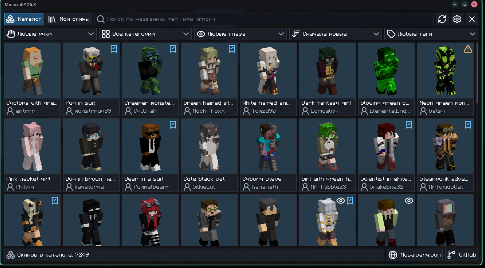
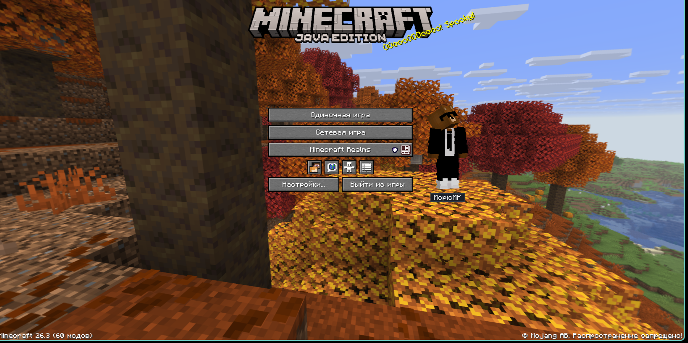
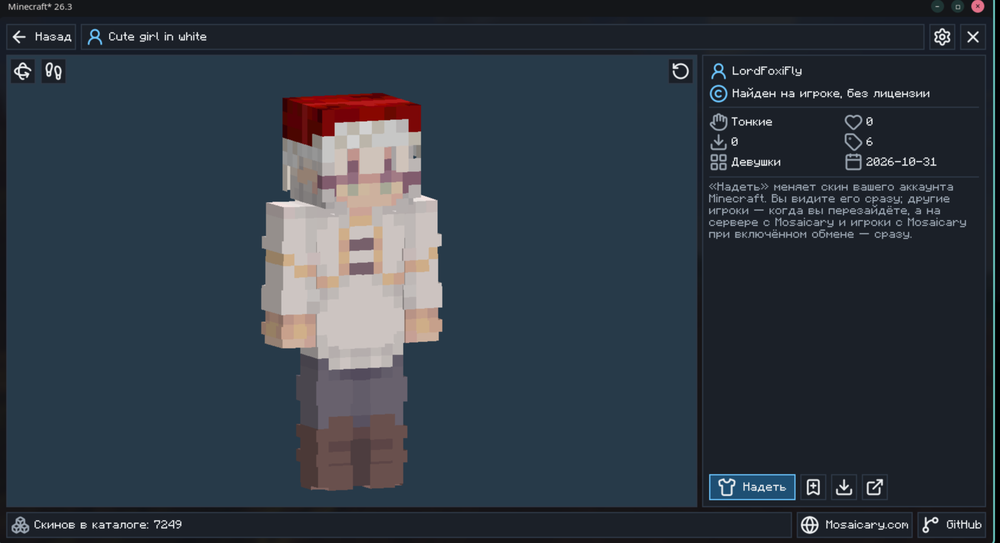
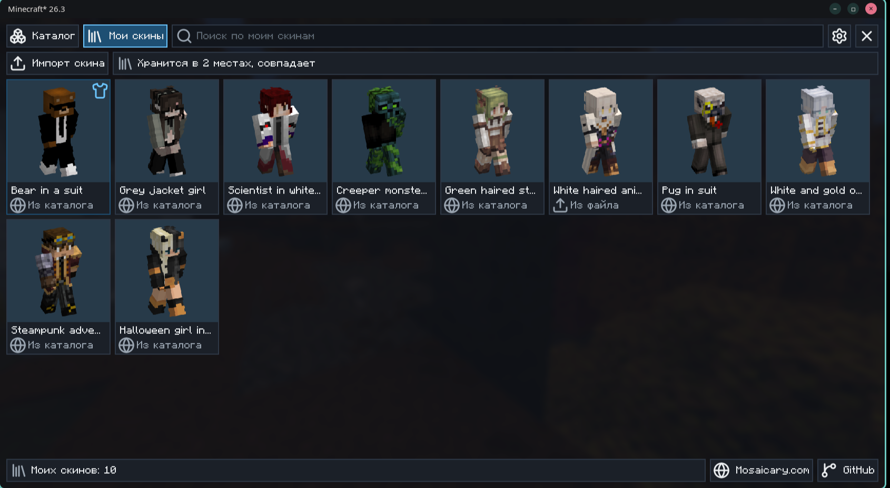

# Mosaicary

A skin wardrobe for Minecraft. Browse the skin catalogue of [mosaicary.com](https://mosaicary.com) in the game, see each skin on the player model, and wear it in one click.

For **Fabric** and **NeoForge**, Minecraft 26.3. [Русский](#русский)

**Download:** [CurseForge](https://www.curseforge.com/minecraft/mc-mods/mosaicary)



> **Please do not upload this mod to CurseForge, Modrinth or anywhere else under your own name.** The licence forbids it, for the mod as it is and for a changed version: see [LICENSE](LICENSE).

## What it does

- **Catalogue.** Search by name, tag or player, and filter by arms, category, live eyes, order and tags. Open it with the M key or the button on the pause menu.
- **Preview.** Every skin stands on the game's own player model: the left mouse button turns it, the right one moves it, the wheel zooms.
- **Wear.** One click puts the skin on your Minecraft account. You see it at once; other players see it when you join again, or at once on a server with Mosaicary.
- **My skins.** The skins you wore or saved, and your own PNG files. Sign in to an account on mosaicary.com, and they come back in any game with the mod.
- **No licence?** Mojang will not take your skin, but with an account on mosaicary.com everybody with the mod sees it.
- **Sharing.** Players with Mosaicary and sharing on see each other's new skins at once, even on servers without the mod.
- **Beside the menus.** Your skin stands next to the main menu and the pause menu. Its place and size are in the settings, and it can be switched off.
- **See-through skins.** They show as drawn, on you and on other players. The mod warns you about them: players without it see those places solid, the clear ones usually black.
- **Live eyes.** Skins marked with an eye blink and look around with the [Fresh Moves+](https://modrinth.com/resourcepack/freshmoves) resource pack, [Entity Model Features](https://modrinth.com/mod/entity-model-features) and [Entity Texture Features](https://modrinth.com/mod/entitytexturefeatures). The wardrobe says if something is missing.







## Requirements

- Minecraft 26.3
- Java 25
- On Fabric: Fabric Loader 0.19.5 or newer and Fabric API
- On NeoForge: NeoForge for 26.3

Each loader has its own file; take the one for yours.

Optional: on Fabric, [Mod Menu](https://modrinth.com/mod/modmenu), for the settings button in its list (on NeoForge the settings open from the Config button in the mod list), and the three projects under Live eyes above. The mod works without them, in single player and on any server. The server does not need it.

The mod's interface is translated into English, Russian, German, Spanish, French, Italian, Japanese, Korean, Dutch, Polish, Brazilian Portuguese, Turkish, Ukrainian and Simplified Chinese.

## What goes to mosaicary.com

The catalogue comes from the site. With sharing on, which the mod asks about on your first Wear, the site keeps the skin you wear and your player id, so that other players with the mod can see it. If you turn on My skins on the site or sign in to an account there, it also keeps the list of your skins and your own skin files. "Delete my data" in the mod's settings removes all of it. More at [mosaicary.com/data](https://mosaicary.com/data).

## Building from source

You need JDK 25; Gradle finds it by itself once it is installed.

```
./gradlew build
```

The jars land in `versions/26.3-fabric/build/libs/` and `versions/26.3-neoforge/build/libs/`. Both are built from the one source in `src/`: lines marked `//#if FABRIC` or `//#if NEOFORGE` are kept for one loader only.

```
./gradlew test
./gradlew :26.3-fabric:runClientGameTest
```

The first runs the tests that need no game. The second starts the game and drives it with real input, and it needs a connection to mosaicary.com for the catalogue.

The source also holds parts this release keeps hidden: worn 3D models and a quick ring. They may change or go away.

## Licence

All rights reserved. You may read the source and build it for yourself; publishing it is not allowed. The full terms are in [LICENSE](LICENSE). To ask about anything else: contact@mosaicary.com.

The hat on the mod's icon is "[Fancy Hat [ minecraft style ]](https://sketchfab.com/3d-models/fancy-hat-minecraft-style-b0f3fade197b44119939bd324c944a7a)" by [LepikGem](https://sketchfab.com/LepikGem), under [CC BY 4.0](https://creativecommons.org/licenses/by/4.0/), put on the author's own model and rendered as the icon.

Not an official Minecraft product. Not approved by or associated with Mojang or Microsoft.

---

# Русский

Гардероб скинов для Minecraft. Каталог скинов с [mosaicary.com](https://mosaicary.com) прямо в игре: посмотреть скин на модели игрока и надеть его одним нажатием.

Для **Fabric** и **NeoForge**, Minecraft 26.3.

**Скачать:** [CurseForge](https://www.curseforge.com/minecraft/mc-mods/mosaicary)

> **Пожалуйста, не выкладывайте этот мод на CurseForge, Modrinth и куда-либо ещё под своим именем.** Лицензия запрещает это и для самого мода, и для изменённой версии: см. [LICENSE](LICENSE).

## Что умеет

- **Каталог.** Поиск по названию, тегу и игроку, фильтры по рукам, категории, живым глазам, порядку и тегам. Открывается клавишей M или кнопкой в меню паузы.
- **Просмотр.** Каждый скин стоит на настоящей модели игрока: левая кнопка мыши вращает, правая двигает, колесо приближает.
- **Надеть.** Одно нажатие меняет скин вашего аккаунта Minecraft. Вы видите его сразу, другие игроки после перезахода, а на сервере с Mosaicary сразу.
- **Мои скины.** Скины, которые вы надевали или сохранили, и ваши PNG-файлы. Войдите в аккаунт на mosaicary.com, и они появятся в любой игре с этим модом.
- **Нет лицензии?** Mojang не примет ваш скин, но с аккаунтом на mosaicary.com его увидят все игроки с модом.
- **Обмен.** Игроки с Mosaicary и включённым обменом сразу видят новые скины друг друга, даже на серверах без мода.
- **Рядом с меню.** Ваш скин стоит рядом с главным меню и меню паузы. Положение и размер меняются в настройках, показ можно выключить.
- **Полупрозрачные скины.** Выглядят так, как нарисованы, и на вас, и на других игроках. Мод предупреждает о них: игроки без мода видят такие места сплошными, а прозрачные обычно чёрными.
- **Живые глаза.** Скины со значком глаза моргают и смотрят по сторонам с ресурспаком [Fresh Moves+](https://modrinth.com/resourcepack/freshmoves) и модами [Entity Model Features](https://modrinth.com/mod/entity-model-features) и [Entity Texture Features](https://modrinth.com/mod/entitytexturefeatures). Если чего-то не хватает, гардероб об этом скажет.

## Что нужно

- Minecraft 26.3
- Java 25
- На Fabric: Fabric Loader 0.19.5 или новее и Fabric API
- На NeoForge: NeoForge для 26.3

У каждого загрузчика свой файл, берите тот, что для вашего.

Необязательно: на Fabric — [Mod Menu](https://modrinth.com/mod/modmenu), чтобы открывать настройки из его списка (на NeoForge они открываются кнопкой Config в списке модов), и три проекта из пункта про живые глаза. Мод работает и без них, в одиночной игре и на любом сервере. Серверу мод не нужен.

Интерфейс мода переведён на английский, русский, немецкий, испанский, французский, итальянский, японский, корейский, нидерландский, польский, бразильский португальский, турецкий, украинский и упрощённый китайский.

## Что уходит на mosaicary.com

Каталог приходит с сайта. При включённом обмене, о котором мод спросит при первом «Надеть», сайт хранит надетый скин и идентификатор игрока, чтобы его видели другие игроки с модом. Если включить «Мои скины на сайте» или войти там в аккаунт, сайт хранит ещё список ваших скинов и ваши файлы скинов. Кнопка «Удалить мои данные» в настройках мода стирает всё это. Подробнее: [mosaicary.com/data](https://mosaicary.com/data).

## Сборка

Нужен JDK 25.

```
./gradlew build
```

Готовые файлы появятся в `versions/26.3-fabric/build/libs/` и `versions/26.3-neoforge/build/libs/`. Оба собираются из одного кода в `src/`: строки с пометкой `//#if FABRIC` или `//#if NEOFORGE` остаются только для своего загрузчика.

## Лицензия

Все права защищены. Код можно читать и собирать для себя, выкладывать нельзя. Полный текст в [LICENSE](LICENSE). С другими вопросами: contact@mosaicary.com.

Шляпа на иконке мода — «[Fancy Hat [ minecraft style ]](https://sketchfab.com/3d-models/fancy-hat-minecraft-style-b0f3fade197b44119939bd324c944a7a)» от [LepikGem](https://sketchfab.com/LepikGem), лицензия [CC BY 4.0](https://creativecommons.org/licenses/by/4.0/); она надета на собственную модель автора мода и отрисована как иконка.

Это не официальный продукт Minecraft. Проект не одобрен Mojang или Microsoft и не связан с ними.
